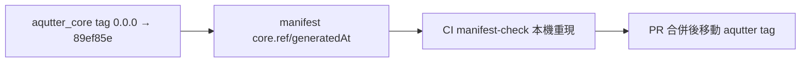

# Plan: 2611201511-sync-after-macos-passthrough
- Created: 2026-11-20
- Branch: feature/2611201511-sync-after-macos-passthrough
- Issue: Aqutter/aqutter#82
- Milestone: N/A（未指定）
- Base Branch: main
- Status: Awaiting Archive
- Completed: [Wait for Finish]

## Goals
把框架的 release 資訊前進到 macOS 穿透合併之後：`aqutter_core` main 為 `89ef85e`（PR `Aqutter/aqutter_core#42`），本 repo 跟上它。來源是前一份計畫 `2611201345-macos-passthrough`（`aqutter_core`）留下的人工收尾事項，使用者回覆「都做」。

## Architecture

`manifest/releases.json:3,20`（`generatedAt`、`core.ref`）前進；`docs/nativeview.md:94` 的 `auto` 平台說明加入 macOS（Android、iOS、macOS、Windows）。wiki 沒有寫死平台清單（已檢視 `platform/architecture.md`、`platform/webview-transparency.md`），不改。程式碼風格：只改 JSON 與 Markdown。

## Cross-Repo Scope
- **本計畫所屬 repo**: `aqutter`
- **共用計畫 ID**: `2611201511-sync-after-macos-passthrough`　**共用分支名**: `feature/2611201511-sync-after-macos-passthrough`（`aqutter-nuxt-app` 不開分支，直接推 `main`）
- **參與 repo 與職責**:
  - `aqutter` — `manifest/releases.json` 的 `core.ref` 與 `generatedAt`、`docs/nativeview.md` 的平台說明（契約正本）　issue: `Aqutter/aqutter#82`
  - `aqutter-cli` — 內建快照 `src/manifestSnapshot.json` 與 `dist/aqutter.mjs`　issue: `待建立`
  - `aqutter-nuxt-app` — 鎖定前進；依其 `project.md` 不開 PR、不綁 issue、直接推 `main`
  - 上游 `aqutter_core`（PR `Aqutter/aqutter_core#42` 已合併，main `89ef85e`）只移動 `0.0.0` tag
- **執行順序相依**: `aqutter_core` tag → `aqutter` 合併 → `aqutter` tag → `aqutter-cli` 合併 → `aqutter-cli` tag → `aqutter-nuxt-app` 鎖定與 tag。
- **跨 repo 檔案指涉**: 無。

## Contract / 介面契約
- **契約正本 repo**: `aqutter`　**修訂號**: `rev 1`　**狀態**: `草擬`

### 1. 端點
無端點。契約對象是 `manifest/releases.json`（schema 1）：本次只改 `core.ref`（`671bef98208069983843c2f9517b8e3098b9b4cc` → `89ef85e…` 全長，以 `git rev-parse` 取得）與 `generatedAt`；其餘欄位不動（`shell.ref` 必須維持等於 `git log -1 -- shell`，`client.spec` 不變）。

### 2. 欄位
`releases["0.0.0"].core.ref`：字串，40 位小寫十六進位 commit sha，必須存在於 `core.url` 的遠端。`generatedAt`：UTC ISO 8601，到秒，`Z` 結尾。

### 3. 錯誤碼
無。檢查失敗以 CI `manifest-check` 的訊息為準（schema、ref 存在、`shell.ref`、Flutter 基準）。

### 4. 狀態與規則
`aqutter-cli` 的 `src/manifestSnapshot.json` 必須與正本逐字相同（`cmp` 無差異），以 `pnpm manifest:sync` 產生；`aqutter-nuxt-app` 以 `aqutter upgrade` 與 `flutter pub upgrade aqutter aqutter_core` 跟進。

### 5. 相容性
只前進 `core.ref`，不改 schema；舊版 CLI 讀新 manifest 不受影響。

### 6. 變更紀錄
- _(尚無)_

## Impact Files
- `manifest/releases.json:3,20` — `generatedAt`、`core.ref`
- `docs/nativeview.md:94` — `auto` 的平台說明加入 macOS

## Open Questions / 待確認事項
無。決策見 `## Key Decisions`。

## Manual Follow-ups / 人工收尾事項
- **[合併後]** macOS release 建置、Intel Mac 與其他 macOS 版本未驗證（前一份計畫已記錄）— 在其他機器跑 `aqutter dev macos` — agent 沒有其他機器
- **[合併後]** 各 repo 的 `0.0.0` tag 是浮動 tag，移動為強制更新；舊值記在 `## Key Decisions` — 使用者已在核准閘核准移動

## Key Decisions
- **[Phase 0]** 目標 repo：`aqutter`、`aqutter-cli`、`aqutter-nuxt-app`（各一份計畫）。
- **[tag]** `0.0.0` 是浮動 tag，核准閘請示移動；舊值：`aqutter_core` `671bef9…`、`aqutter` `e4f7d91…`（移動時再記全長）。
- **[完成後]** commit + 開 PR（待核准閘確認）。

## Git Completion Policy
- PR 一律以 `--base main` 顯式指定。每個 commit 與 PR body 含 `Closes #<issue>`。
- commit 自動；完成時 `git fetch` 後 `git rebase origin/main` 並 `git push --force-with-lease --force-if-includes`（待核准閘確認選項）。

## References
- `aqutter_core` 的 `.kn-project/archive/2611201345-macos-passthrough.md`；前例 `2611190044-sync-after-native-touch`（各 repo 的 archive）。
- **[核准]** 計畫、issue／分支建立、tag 移動、Milestone 不指定、完成後 commit + 開 PR — 使用者核准。
- **[tag 已移]** `aqutter_core` `0.0.0`：舊值 `671bef98208069983843c2f9517b8e3098b9b4cc` → `89ef85e3b6afa8d3ae50b5bc39012d60a668f024`。
